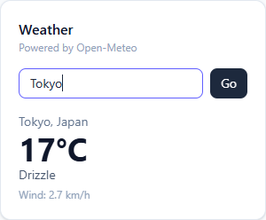

# Task Manager

**Live Demo:** https://task-management-seven-blue.vercel.app

A full stack task management app built with Next.js (App Router), Neon PostgreSQL and Tailwind CSS. Ready to deploy on Vercel.

## Features

- Add, edit, delete tasks
- Mark tasks as completed
- Filter by all / active / completed
- Responsive layout (mobile, tablet, desktop)
- Live weather widget using a third party API (Open-Meteo)

## Tech Stack

| Layer     | Technology                       |
| --------- | -------------------------------- |
| Frontend  | Next.js 16, React 19, Tailwind 4 |
| Validation | Zod                             |
| HTTP client | Axios                          |
| Backend   | Next.js Route Handlers (REST)    |
| Database  | Neon (PostgreSQL)                |
| Hosting   | Vercel                           |

## Project Structure

```
app/
  api/
    tasks/route.ts              GET, POST
    tasks/[id]/route.ts         PUT, PATCH, DELETE
    weather/route.ts            GET (third party API)
  page.tsx
components/
  tasks/                        TaskManager, TaskForm, TaskItem, TaskList, TaskFilter
  weather/                      WeatherWidget
  ui/                           Button, Card, Input, Textarea, Alert
hooks/
  useTasks.ts                   Task state and actions
  useWeather.ts                 Weather state and search
lib/
  api/                          Axios client and API calls used by the frontend
    client.ts
    tasks.api.ts
    weather.api.ts
  controllers/                  Request handling and responses
    task.controller.ts
    weather.controller.ts
  validations/                  Zod schemas for request validation
    task.schema.ts
    weather.schema.ts
  services/                     Database and external API logic
    task.service.ts
    weather.service.ts
  models/                       Task and Weather types
  utils/http.ts                 HttpError, validate(), JSON helpers, error handling
  db.ts                         Neon connection
db/schema.sql                   Database schema
scripts/setup-db.mjs            Creates the tasks table
```

Frontend flow: `component -> hook -> lib/api (axios) -> /api route`

Backend flow: `route -> controller -> zod schema (validate) -> service -> database / external API`

## Setup Instructions

1. Clone the repository

   ```bash
   git clone https://github.com/AbdulMaroof1/task-management.git
   cd task-management
   npm install
   ```

2. Create a project on [Neon](https://neon.tech) and copy the connection string.

3. Create a `.env` file in the project root (see `.env.example`):

   ```env
   DATABASE_URL="postgresql://<user>:<password>@<host>.neon.tech/<database>?sslmode=require"
   WEATHER_API_URL="https://api.open-meteo.com/v1/forecast"
   GEOCODING_API_URL="https://geocoding-api.open-meteo.com/v1/search"
   ```

4. Create the database table

   ```bash
   npm run db:setup
   ```

   Or run the contents of `db/schema.sql` in the Neon SQL Editor.

5. Start the app

   ```bash
   npm run dev
   ```

   Open http://localhost:3000

## Deploy to Vercel

1. Push the repository to GitHub.
2. Import the repository in Vercel.
3. Add `DATABASE_URL` (and optionally `WEATHER_API_URL`, `GEOCODING_API_URL`) under Project Settings > Environment Variables.
4. Deploy.

## Database Schema

```sql
CREATE TABLE IF NOT EXISTS tasks (
  id          SERIAL PRIMARY KEY,
  title       VARCHAR(255) NOT NULL,
  description TEXT NOT NULL DEFAULT '',
  completed   BOOLEAN NOT NULL DEFAULT FALSE,
  created_at  TIMESTAMPTZ NOT NULL DEFAULT NOW(),
  updated_at  TIMESTAMPTZ NOT NULL DEFAULT NOW()
);
```

| Column      | Type         | Notes                  |
| ----------- | ------------ | ---------------------- |
| id          | SERIAL       | Primary key            |
| title       | VARCHAR(255) | Required               |
| description | TEXT         | Defaults to empty text |
| completed   | BOOLEAN      | Defaults to false      |
| created_at  | TIMESTAMPTZ  | Set on insert          |
| updated_at  | TIMESTAMPTZ  | Set on every update    |

## REST API

| Method | Endpoint          | Description       | Body                                     |
| ------ | ----------------- | ----------------- | ---------------------------------------- |
| GET    | `/api/tasks`      | Get all tasks     | -                                        |
| POST   | `/api/tasks`      | Create a task     | `{ "title": "...", "description": "..." }` |
| PUT    | `/api/tasks/:id`  | Update a task     | `{ "title"?, "description"?, "completed"? }` |
| DELETE | `/api/tasks/:id`  | Delete a task     | -                                        |
| GET    | `/api/weather?city=London` | Current weather for a city | -                    |

Postman collection: [proof/task-management.postman_collection.json](proof/task-management.postman_collection.json) (import it in Postman and run).

Example:

```bash
curl -X POST http://localhost:3000/api/tasks \
  -H "Content-Type: application/json" \
  -d '{"title":"Buy groceries","description":"Milk and eggs"}'
```

## API Integration

**API used:** [Open-Meteo](https://open-meteo.com) (Geocoding API + Forecast API). Free, no API key required.

**Implementation:**

1. The frontend `WeatherWidget` calls our own endpoint `/api/weather?city=<name>`.
2. `weather.controller.ts` validates the `city` query param with Zod and calls `weather.service.ts`.
3. The service calls the Open-Meteo Geocoding API to convert the city name into latitude and longitude, then calls the Forecast API for current weather.
4. The weather code is mapped to a readable description and a clean JSON object is returned to the client.
5. Responses from the forecast API are cached for 10 minutes using Next.js `fetch` revalidation.

Calling the third party API from the server keeps external URLs in environment variables and gives the client one consistent response shape.

**Screenshot:**



More screenshots and the full API test log are in the [proof](proof/README.md) folder.
