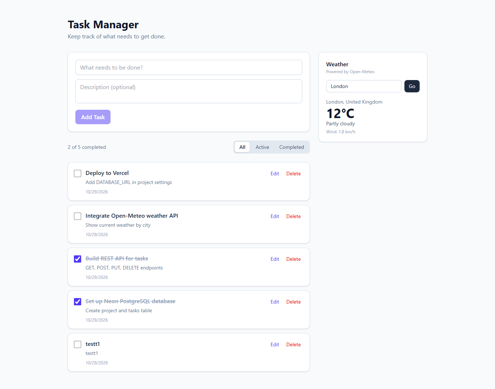
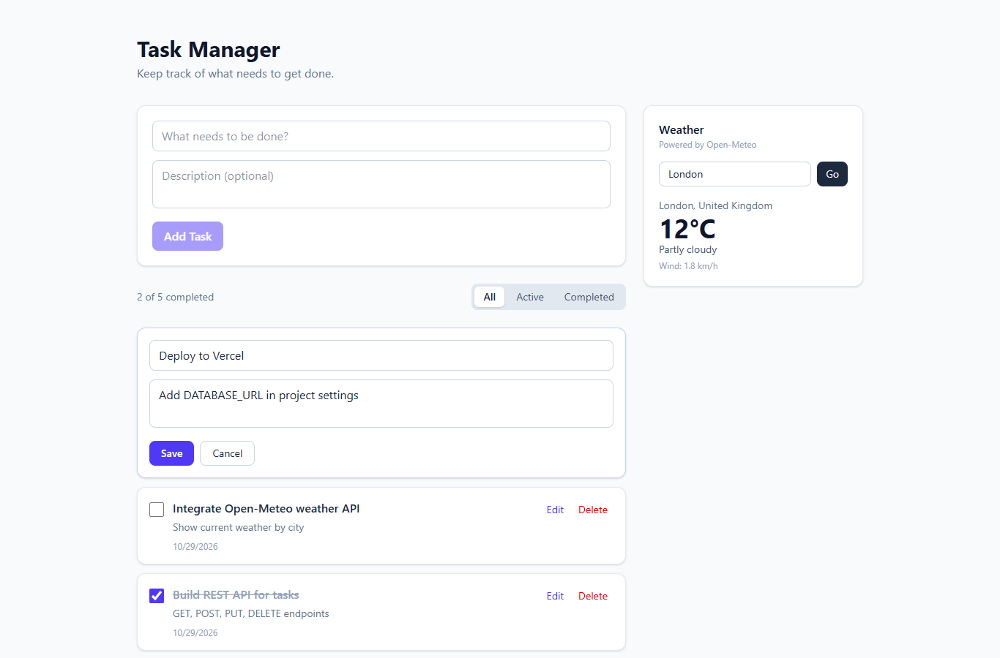
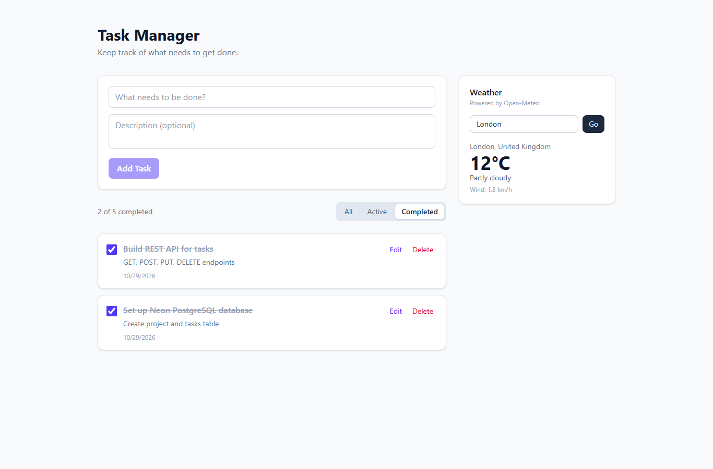
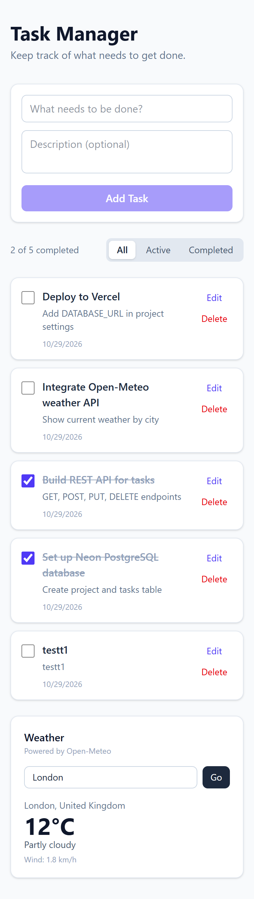
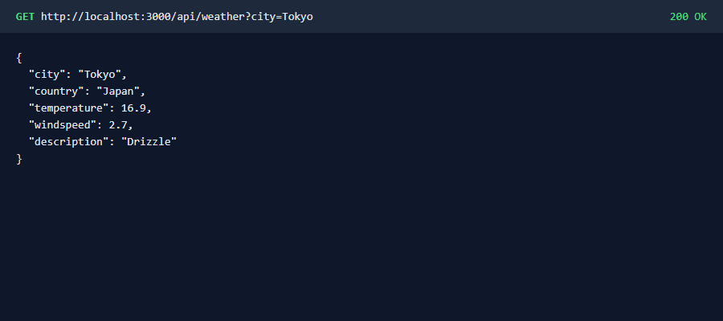
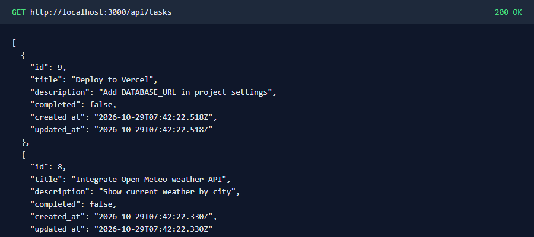

# Proof of Work

Screenshots captured from the running app (`npm run dev`) connected to Neon PostgreSQL.

## Frontend

| Screenshot | Shows |
| --- | --- |
| [01-desktop-task-list.png](01-desktop-task-list.png) | Task list on desktop with completed and active tasks |
| [02-mobile-task-list.png](02-mobile-task-list.png) | Responsive layout on a 390px mobile screen |
| [03-edit-task.png](03-edit-task.png) | Editing a task inline |
| [04-completed-filter.png](04-completed-filter.png) | Filtering completed tasks |

## API Integration (Open-Meteo)

| Screenshot | Shows |
| --- | --- |
| [05-weather-integration.png](05-weather-integration.png) | Weather widget showing live data for Tokyo |
| [07-api-weather.png](07-api-weather.png) | `GET /api/weather?city=Tokyo` response |

## REST API

| Screenshot | Shows |
| --- | --- |
| [06-api-get-tasks.png](06-api-get-tasks.png) | `GET /api/tasks` response from the database |

Full request and response log for create, read, update, complete, delete and validation: [api-test-results.md](api-test-results.md)
